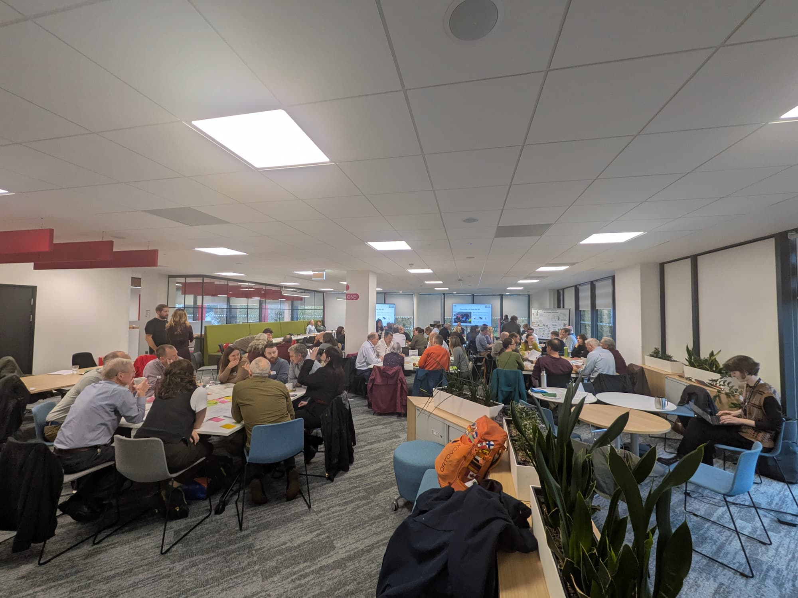

- The public launch of the [[Taff Catchment Partnership]], held at the [[Transport for Wales]] office at [[Pontypridd]].
- {:height 399, :width 512}
- Speakers included:
	- [[David Clubb]] of the [[Taff Catchment Partnership]]
	- [[David Letellier]] of [[Natural Resources Wales]]
	- [[Becky Davies]] of [[Natural Resources Wales]]
	- [[Will Millard]]
	- [[Liz Jenkins]] of the [[Wales Flood Forum]]
	- [[Dr Eurgain Powell]] of [[Public Health Wales]]
	- [[Professor Steve Ormerod]] of [[Cardiff University]]
	- [[Chris Uttley]] of [[Stroud District Council]]
	- [[Elspeth Jones]] of the [[Usk Catchment Partnership]]
	- [[Professor Tom Entwhistle]] of [[Cardiff University]]
-